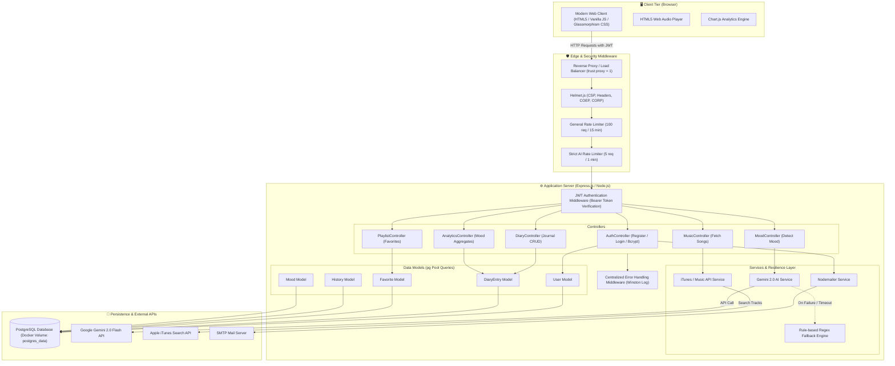
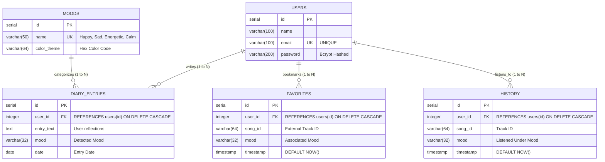

# 💜 Moodify — Infosys Comprehensive Interview Master Guide

> **Target Role:** Infosys (System Engineer / Digital Specialist Engineer / Specialist Programmer)  
> **Topic:** End-to-End Project Architecture, Database Modeling, System Flow & Docker Mastery

---

## 📌 Table of Contents
1. [Section 1: The Perfect Project Introduction (Elevator Pitches)](#section-1-the-perfect-project-introduction)
2. [Section 2: Tech Stack Justifications (Why did you choose this?)](#section-2-tech-stack-justifications)
3. [Section 3: End-to-End System Architecture (Visual Flowchart)](#section-3-end-to-end-system-architecture)
4. [Section 4: Database Schema & Entity Relationships (ER Diagram)](#section-4-database-schema--entity-relationships)
5. [Section 5: Complete Docker Tutorial & Interview Guide](#section-5-complete-docker-tutorial--interview-guide)
6. [Section 6: Top 10 Infosys Interview Q&A for this Project](#section-6-top-10-infosys-interview-qa)

---

<a name="section-1-the-perfect-project-introduction"></a>
## 🎙️ Section 1: The Perfect Project Introduction

When the interviewer says: **"Tell me about your project"** or **"Walk me through what you built"**, do NOT just list features. Use the structured **Problem $\rightarrow$ Solution $\rightarrow$ Architecture $\rightarrow$ Impact** formula.

### Option A: The 30-Second Quick Pitch
> *"I built **Moodify**, an AI-powered emotional music and mood-tracking platform. The application uses **Google Gemini 2.0 Flash AI** to analyze a user's real-time thoughts or diary entries, determine their underlying sentiment, and instantly curate a matching music playlist using the iTunes Music API. The backend is built with **Node.js, Express, and PostgreSQL**, featuring **JWT authentication, strict rate limiting, Helmet security headers**, and an automated fallback engine that guarantees 100% uptime even if external AI APIs fail."*

---

### Option B: The 2-Minute Detailed Pitch (Recommended)
> *"In modern digital life, music streaming platforms recommend songs based on past listening history, but they fail to capture how a person feels in the exact moment. I wanted to build an application where emotional self-reflection directly translates into an immersive musical experience.*
>
> *I designed and developed **Moodify**, a full-stack web application. Here is how it works:*
> 1. ***User Interaction & Journaling:*** *A user logs in and can either write a short journal entry or pick their current vibe.*
> 2. ***AI Sentiment Analysis:*** *The backend passes this text to **Google Gemini 2.0 Flash** via a custom prompt engine that returns standardized emotional tags (Happy, Sad, Energetic, Calm) with confidence scores. If the AI service experiences network latency or quota exhaustion, I built an automated keyword-based regex fallback engine so user requests never fail.*
> 3. ***Dynamic Music Recommendation:*** *Based on the detected sentiment, the system queries the iTunes Search API to fetch high-fidelity track previews, album art, and artist details.*
> 4. ***Analytics & Tracking:*** *Every mood and diary entry is stored in a **PostgreSQL** relational database. Using **Chart.js**, the user gets a 10-day emotional volatility timeline and mood distribution chart to track their mental wellness.*
> 5. ***Production Engineering:*** *On the backend, I implemented production-grade standards: **Helmet.js** for Content Security Policy, **express-rate-limit** to prevent DDoS and API cost-burn, **Winston** for structured logging instead of volatile console logs, and containerized the entire ecosystem using **Docker and Docker Compose**."*

---

<a name="section-2-tech-stack-justifications"></a>
## ⚙️ Section 2: Tech Stack Justifications

Interviewers will ask: *"Why did you choose this technology instead of X?"* Here are your bulletproof answers:

| Component | Technology | Why Chosen? (Interview Answer) |
| :--- | :--- | :--- |
| **Backend** | Node.js + Express.js | Non-blocking, event-driven I/O makes it ideal for handling asynchronous third-party API calls (Gemini AI, iTunes API) and concurrent database queries with low latency. |
| **Database** | PostgreSQL | Strict ACID compliance, relational integrity (Foreign Keys linking users to favorites, history, and diary logs), and robust aggregate functions for mood analytics. |
| **AI Model** | Google Gemini 2.0 Flash | Ultra-low latency, structured JSON response formatting, cost-efficient token usage, and accurate emotional nuance detection. |
| **Frontend** | Vanilla JS (ES6+), HTML5, Glassmorphism CSS | Zero build overhead, blazing-fast client load times, and complete control over the DOM and HTML5 Audio API without heavy framework bloat. |
| **Security** | JWT + Bcrypt + Helmet + Rate Limiting | Stateless, scalable authentication (JWT) with salted password hashing (Bcrypt), combined with network layer attack mitigation (XSS, clickjacking, brute-force). |
| **Observability** | Winston Logger | Replaces `console.log` with categorized log levels (`info`, `warn`, `error`), timestamps, and JSON formatting ready for log management tools. |
| **DevOps** | Docker & Docker Compose | Solves the "it works on my machine" problem by bundling the Node app and PostgreSQL database with persistent storage in identical isolated environments. |

---

<a name="section-3-end-to-end-system-architecture"></a>
## 🏛️ Section 3: End-to-End System Architecture

### Visual Architectural Flowchart



### Request Lifecycle (How a Request Travels):
1. **User Request**: The user enters a diary entry on `diary.html` and clicks *"Detect Mood & Get Music"*.
2. **Reverse Proxy & Security**: Express receives the request behind the proxy (`trust proxy: 1`). `helmet` validates the request origin, and `express-rate-limit` ensures the user hasn't exceeded 5 requests/minute.
3. **Authentication**: `auth.js` middleware extracts the `Authorization: Bearer <token>` header, decodes the JWT using `process.env.JWT_SECRET`, and attaches `req.user = { id: user.id }`.
4. **Sentiment Processing**: `moodController.js` calls `geminiService.js`. If Gemini succeeds, it returns the mood; if the API times out, the built-in regex fallback analyzes sentiment keywords.
5. **Music Query**: The detected mood (e.g., "Calm") triggers `spotifyService.js` to search tracks from the iTunes API.
6. **Database Persistence**: `diaryController.js` and `historyController.js` save the entry and songs into PostgreSQL using parameterized SQL queries.
7. **Response & Visualization**: The frontend receives JSON, updates the DOM, triggers audio streaming, and redraws the mood trend line chart using Chart.js.

---

<a name="section-4-database-schema--entity-relationships"></a>
## 🗄️ Section 4: Database Schema & Entity Relationships

### Entity-Relationship (ER) Diagram



### Key Relational Design Decisions:
1. **`ON DELETE CASCADE`**:
   * If a user deletes their account from `users`, all their records in `diary_entries`, `favorites`, and `history` are automatically deleted by the database engine. This prevents orphaned records and maintains data integrity.
2. **Compound Unique Constraint (`unique_user_song`)**:
   * In `favorites`: `CONSTRAINT unique_user_song UNIQUE (user_id, song_id)`.
   * **Why?** A user should never be able to favorite the exact same song twice. By enforcing this at the database constraint level (instead of only in application code), we prevent race conditions and duplicate rows.
3. **Pre-Seeded `moods` Table**:
   * Stores predefined moods (`Happy`, `Sad`, `Energetic`, `Calm`) with their UI color codes (`#FFD700`, `#74b9ff`, `#e17055`, `#81ecec`) with `ON CONFLICT (name) DO NOTHING` for idempotent migrations.

---

<a name="section-5-complete-docker-tutorial--interview-guide"></a>
## 🐳 Section 5: Complete Docker Tutorial & Interview Guide

### 1. What is Docker, and why do we use it?
* **The Problem It Solves**: In software development, code often works on a developer's machine but fails on a teammate's computer or production server due to different Node versions, missing environment variables, or database configuration mismatches (*"It worked on my machine!"*).
* **The Solution**: Docker packages an application **and all its dependencies, runtime, libraries, and configurations** into a lightweight, standalone, executable package called a **Container**.
* **Container vs Virtual Machine (VM)**:
  * **Virtual Machine**: Packages a full Guest Operating System (Gigabytes in size, slow to boot, heavy CPU/RAM usage).
  * **Docker Container**: Shares the host machine's OS kernel, isolating only the application process (Megabytes in size, boots in seconds, extremely lightweight).

---

### 2. Line-by-Line Breakdown of Moodify's `Dockerfile`

Here is the exact `Dockerfile` in your repository:

```dockerfile
# 1. Base Image
FROM node:20

# 2. Working Directory
WORKDIR /usr/src/app

# 3. Dependency Layer Caching
COPY package*.json ./

# 4. Install Dependencies
RUN npm install

# 5. Copy Application Source Code
COPY . .

# 6. Expose Port
EXPOSE 8000

# 7. Container Startup Command
CMD ["npm", "start"]
```

#### Line Explanations:
1. `FROM node:20`: Pulls an official, pre-configured Linux image that has Node.js version 20 and npm pre-installed.
2. `WORKDIR /usr/src/app`: Creates and sets the default working directory inside the container. All subsequent commands (`COPY`, `RUN`, `CMD`) execute here.
3. `COPY package*.json ./`: Copies `package.json` and `package-lock.json` into the container.
   * **⭐ High-Yield Interview Concept (Docker Layer Caching):** Why don't we copy all files at once (`COPY . .`) first?  
     *Docker builds images in cached layers.* Source code changes frequently, but dependencies change rarely. By copying `package.json` and running `RUN npm install` *before* copying the rest of the code, Docker caches the `node_modules` layer. When you edit a JavaScript file, Docker skips `npm install` and builds in under 2 seconds!
4. `RUN npm install`: Executes inside the image during the build phase to install all production and development dependencies.
5. `COPY . .`: Copies the remaining project code (frontend, backend, config) into the container. (The `.dockerignore` file prevents `node_modules` from being copied from the host).
6. `EXPOSE 8000`: Acts as documentation informing Docker that the container listens on port 8000 at runtime.
7. `CMD ["npm", "start"]`: The command executed when the container starts. Unlike `RUN` (which runs at build time), `CMD` runs at container launch.

---

### 3. Understanding Multi-Container Orchestration (`docker-compose.yml`)

Your project has **two moving parts**: the Node.js application and the PostgreSQL database. `docker-compose` allows you to spin up both with a single command.

```yaml
version: '3.8'

services:
  # Service 1: The PostgreSQL Database
  db:
    image: postgres:15
    restart: always
    environment:
      POSTGRES_USER: user
      POSTGRES_PASSWORD: password
      POSTGRES_DB: moodify
    ports:
      - "5432:5432"
    volumes:
      - postgres_data:/var/lib/postgresql/data # Persistent Data Storage

  # Service 2: The Node.js Web Application
  app:
    build: .
    ports:
      - "8000:8000"
    env_file:
      - .env
    environment:
      - DATABASE_URL=postgres://user:password@db:5432/moodify
      - PORT=8000
    depends_on:
      - db

volumes:
  postgres_data:
```

#### Key Architecture Concepts in `docker-compose`:
1. **Container Networking & Service Discovery**:
   * Look at the database URL: `postgres://user:password@db:5432/moodify`.
   * Notice the host is not `localhost` or an IP address — it is **`db`**!
   * Docker Compose creates an internal virtual network where containers can discover each other automatically by their service name (`db`).
2. **Data Persistence via Named Volumes (`postgres_data`)**:
   * By default, containers are **stateless and ephemeral** (if a container is deleted, all data inside it is wiped).
   * By mounting `postgres_data:/var/lib/postgresql/data`, PostgreSQL data is stored safely on the host machine's drive. If the database container stops or restarts, the user data remains intact.
3. **`depends_on`**:
   * Ensures the `db` container starts up before the `app` container attempts to connect.

---

### 4. Top Docker Commands Cheat Sheet

| Command | What it does |
| :--- | :--- |
| `docker build -t moodify-app .` | Builds an image named `moodify-app` from the `Dockerfile`. |
| `docker run -p 8000:8000 moodify-app` | Runs the container, mapping host port 8000 to container port 8000. |
| `docker-compose up -d` | Builds, creates, and starts all services (`app` and `db`) in detached (background) mode. |
| `docker-compose down` | Stops and removes containers and internal networks. |
| `docker ps` | Lists all currently running containers. |
| `docker logs <container_id>` | Views real-time logs from a specific container. |
| `docker exec -it <container_id> sh` | Opens an interactive terminal inside the running container for debugging. |

---

<a name="section-6-top-10-infosys-interview-qa"></a>
## 💡 Section 6: Top 10 Infosys Interview Q&A for this Project

### Q1: What happens if the Gemini AI API experiences downtime or hits rate limits?
> *"To ensure 100% system availability, I implemented a **Graceful Degradation / Fallback Architecture** in `geminiService.js`. If the external Gemini API call throws a 500, encounters network latency, or hits quota limits, the error is caught, logged via Winston, and the request is immediately routed to a local **Rule-based Keyword/Regex Fallback Engine**. This engine parses the diary text for sentiment keywords and assigns a mood so the user experience is never interrupted."*

### Q2: How does user authentication work end-to-end?
> *"I implemented stateless authentication using **JSON Web Tokens (JWT)** and **Bcrypt**:*
> 1. *During registration, the user's password is encrypted using `bcrypt.hash()` with a salt factor of 10 before saving to PostgreSQL.*
> 2. *During login, `bcrypt.compare()` verifies the plaintext password against the database hash.*
> 3. *Upon success, the server signs a JWT containing the user's ID (`jwt.sign({ id }, SECRET, { expiresIn: '7d' })`) and returns it to the client.*
> 4. *For protected routes (like adding favorites or saving diary entries), the client sends the token in the `Authorization: Bearer <token>` header. Our `auth.js` middleware validates the signature and populates `req.user`."*

### Q3: Why did you use `express-rate-limit` and `app.set('trust proxy', 1)`?
> *"Rate limiting protects our server from Denial of Service (DoS) and brute-force attacks, while also preventing excessive billing on third-party AI APIs. I applied a general limiter of 100 requests per 15 minutes across all `/api/` endpoints, and a strict limiter of 5 requests per minute on `/api/mood/detect`. Because modern cloud servers run behind reverse proxies or load balancers, `app.set('trust proxy', 1)` was required so Express reads the client's real IP address from the `X-Forwarded-For` header rather than treating all incoming requests as originating from the proxy."*

### Q4: Why PostgreSQL instead of MongoDB?
> *"Our application domain is inherently relational: users own diary logs, favorite songs, and listening history. PostgreSQL provides ACID compliance, strong referential integrity with Foreign Keys and `ON DELETE CASCADE`, and unique compound constraints (e.g., `(user_id, song_id)`). It also allows powerful SQL aggregation queries (`COUNT`, `GROUP BY`) required to calculate mood percentages and 10-day volatility for our analytics dashboard."*

### Q5: What is Helmet.js and why is it needed?
> *"Helmet is a security middleware that automatically configures HTTP response headers. In our app, we customized the **Content Security Policy (CSP)** to restrict which domains the browser can download assets from. For example, we explicitly whitelisted Apple Music CDN (`*.mzstatic.com`) for album art and Google Fonts for typography, while disallowing untrusted third-party scripts. This protects our users against Cross-Site Scripting (XSS) and data injection."*

### Q6: What is the difference between `RUN` and `CMD` in a Dockerfile?
> *"**`RUN`** is executed during the image build phase to install packages and prepare the environment (e.g., `RUN npm install`). Its output is saved in the image layers. **`CMD`** specifies the default command executed when a container is actually started from the image (e.g., `CMD ["npm", "start"]`)."*

### Q7: What is the purpose of Docker Volumes?
> *"Docker containers are disposable and stateless by default. If a container stops or is recreated, any data written to its local filesystem is lost. A Docker Volume maps a directory on the host machine to a directory inside the container (e.g., `postgres_data:/var/lib/postgresql/data`), ensuring database records persist across container restarts and updates."*

### Q8: How did you implement structured logging and why not use `console.log`?
> *"`console.log` is synchronous in some environments, lacks log severity levels, cannot be filtered easily, and pollutes production terminal output. I implemented **Winston**, which formats logs into JSON with timestamps and categorization (`info`, `warn`, `error`). In production, this allows error stack traces to be persisted to log files and easily ingested by log monitoring tools."*

### Q9: Can you explain how you structured your backend codebase?
> *"I followed the **MVC (Model-View-Controller) / Service-Repository pattern**:*
> * *`routes/`: Defines the API endpoints and maps them to controllers.*
> * *`middleware/`: Handles cross-cutting concerns (authentication, rate limiting, error catching).*
> * *`controllers/`: Handles HTTP request validation and formats the response.*
> * *`services/`: Encapsulates business logic and external API integrations (Gemini AI, iTunes API).*
> * *`models/`: Manages database queries against PostgreSQL.*
> *This separation of concerns makes the codebase modular, easy to maintain, and testable."*

### Q10: What was the most challenging bug or engineering obstacle you resolved in this project?
> *"One major challenge was handling third-party API latency and rate limits for AI sentiment detection. Initially, when multiple requests hit `/api/mood/detect`, delays from the AI provider caused UI freezing and occasional 429 quota errors. I resolved this with a two-tier strategy: first, by implementing a strict rate limiter (5 req/min) to control outbound burst traffic, and second, by engineering an automatic keyword-based regex fallback engine that catches API exceptions and delivers instantaneous mood detection without degrading the user experience."*
